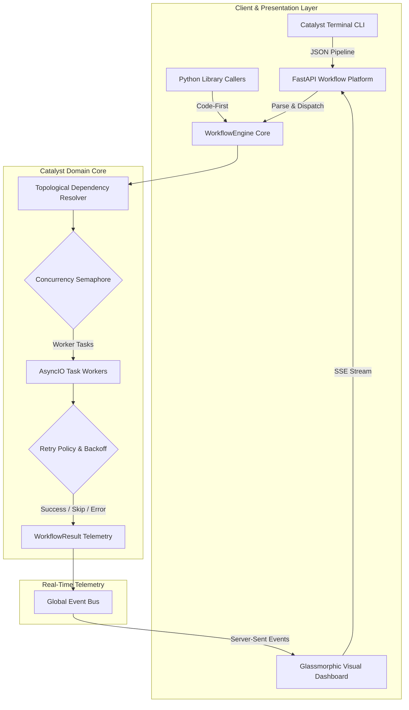

<div align="center">
  
  
  <br/>

  <h1>✨ Catalyst Engine</h1>
  <p><b>High-Performance Parallel DAG Workflow Platform</b></p>
  <i>A microsecond Directed Acyclic Graph (DAG) executor, declarative workflow platform, real-time visual command center, and developer CLI. Zero bloat.</i>

  <br/>
  
  [](https://python.org)
  [](https://fastapi.tiangolo.com/)
  [](LICENSE)
</div>

---

## 📑 Table of Contents
- [🌟 Overview](#-overview)
- [🚀 Enterprise Features](#-enterprise-features)
- [🏗️ System Architecture](#️-system-architecture)
- [⚡ Quick Start Guide](#-quick-start-guide)
- [💻 Comprehensive Usage](#-comprehensive-usage)
  - [1. Data Flow & Upstream Result Injection](#1-data-flow--upstream-result-injection)
  - [2. Decorator API (`@engine.task`)](#2-decorator-api-enginetask)
  - [3. Retries & Concurrency Limiting](#3-retries--concurrency-limiting)
  - [4. Declarative REST API & Real-Time SSE](#4-declarative-rest-api--real-time-sse)
- [🖥️ Real-Time Visual Dashboard](#️-real-time-visual-dashboard)
- [🛠️ Developer CLI](#️-developer-cli)
- [🤝 Contributing](#-contributing)
- [📄 License](#-license)

---

## 🌟 Overview

**Catalyst Engine** is a bare-metal, high-throughput Directed Acyclic Graph (DAG) orchestration platform written in pure Python. It is engineered for orchestrating data pipelines, microservices, and asynchronous task graphs with microsecond dispatch latency—without the memory overhead or infrastructure complexity of heavyweight orchestrators like Airflow or Prefect.

Whether you are embedding a parallel task engine directly inside an async application, utilizing declarative JSON pipelines, or operating the real-time visual dashboard, Catalyst provides raw performance, type safety, and fault tolerance.

---

## 🚀 Enterprise Features

- **⚡ Microsecond DAG Scheduling:** Resolves topological dependencies in microseconds using native `graphlib` and asynchronous event-driven task resolution.
- **🔄 Dynamic Data Flow & Parameter Injection:** Downstream tasks automatically receive results from their dependencies via parameter name matching, positional inputs, `*args`, or dictionary context.
- **🛡️ Fault Tolerance & Retry Policies:** Declarative `RetryPolicy` supporting exponential backoff, jitter, and selective exception filtering before recording a structured `TaskError`.
- **🚦 Concurrency Limiting:** Built-in `max_concurrency` throttling using async semaphores to prevent resource and socket exhaustion under heavy loads.
- **🎨 Ergonomic Decorator Syntax:** Author pipelines naturally with `@engine.task(dependencies=[...], retries=3)`.
- **🖥️ Real-Time Visual Command Center (`/dashboard`):** Self-contained, zero-dependency glassmorphic dashboard featuring live SVG topological graph rendering, execution waterfalls, and telemetry history.
- **📡 Server-Sent Events (SSE) Stream (`/api/v1/stream`):** Live stream delivering real-time lifecycle events (`task_started`, `task_completed`, `task_failed`, `task_skipped`, `task_retrying`).
- **🛠️ High-Performance Developer CLI (`catalyst`):** Terminal CLI for running JSON pipelines, validating DAG syntax and cycles, benchmarking throughput, and launching services.
- **🧩 100% Backward Compatible:** `WorkflowResult` subclasses `dict[str, Any]` for total backward compatibility with existing tests and scripts.

---

## 🏗️ System Architecture



---

## ⚡ Quick Start Guide

### 1. Installation

```bash
git clone https://github.com/shenald-dev/catalyst.git
cd catalyst
pip install -e .
```

### 2. Launching the Command Center

```bash
catalyst serve --port 8080
```
Open your browser:
- 👉 **Visual Dashboard:** `http://localhost:8080/dashboard`
- 👉 **Interactive OpenAPI Docs:** `http://localhost:8080/docs`

---

## 💻 Comprehensive Usage

### 1. Data Flow & Upstream Result Injection

Downstream tasks can declare parameter names matching upstream dependencies to receive their return values:

```python
import asyncio
from catalyst import WorkflowEngine

async def fetch_users() -> list[str]:
    return ["Alice", "Bob", "Charlie"]

async def process_users(fetch_users: list[str]) -> dict[str, int]:
    return {user: len(user) for user in fetch_users}

async def main():
    engine = WorkflowEngine()
    engine.add_task("fetch_users", fetch_users)
    engine.add_task("process_users", process_users, dependencies=["fetch_users"])

    results = await engine.execute()
    print("Processed:", results["process_users"])
    print("Execution Duration:", f"{results.total_duration_ms:.2f} ms")

asyncio.run(main())
```

### 2. Decorator API (`@engine.task`)

```python
import asyncio
from catalyst import WorkflowEngine, RetryPolicy

engine = WorkflowEngine()

@engine.task()
async def extract():
    return [10, 20, 30]

@engine.task(dependencies=["extract"], timeout=2.0)
async def transform(extract):
    return [x * 2 for x in extract]

@engine.task(dependencies=["transform"], retry_policy=RetryPolicy(max_retries=2))
async def load(transform):
    print("Loaded records:", transform)
    return "done"

asyncio.run(engine.execute())
```

### 3. Retries & Concurrency Limiting

```python
from catalyst import WorkflowEngine, RetryPolicy

# Enforce a maximum of 4 tasks executing concurrently
engine = WorkflowEngine(max_concurrency=4)

engine.add_task(
    "api_call",
    call_external_api,
    retry_policy=RetryPolicy(
        max_retries=3,
        delay=0.1,
        backoff=2.0,
        retry_exceptions=(ConnectionError, TimeoutError),
    ),
)
```

### 4. Declarative REST API & Real-Time SSE

Execute arbitrary DAG workflows via HTTP:

```bash
curl -X POST http://localhost:8080/api/v1/workflows/run \
  -H "Content-Type: application/json" \
  -d '{
    "name": "etl_pipeline",
    "tasks": [
      {"name": "extract", "operation": "echo", "payload": [10, 20, 30]},
      {"name": "transform", "operation": "compute", "dependencies": ["extract"]},
      {"name": "load", "operation": "echo", "payload": "Database Synced", "dependencies": ["transform"]}
    ],
    "max_concurrency": 2
  }'
```

---

## 🖥️ Real-Time Visual Dashboard

Access `http://localhost:8080/dashboard` to experience the real-time visual command center:
- **Interactive Topological Graph:** Visualizes node hierarchies, execution status badges, and dependency arrows.
- **Execution Waterfall:** Timeline Gantt bars indicating task durations and critical paths.
- **Live Telemetry Stream:** Real-time event log powered by Server-Sent Events (SSE).
- **History Explorer:** Revisit previous workflow runs, latencies, and error diagnostics.

---

## 🛠️ Developer CLI

Catalyst ships with a terminal CLI:

```bash
# Benchmark engine throughput
catalyst benchmark --nodes 500 --concurrency 50

# Validate DAG syntax and cycle detection without running
catalyst validate pipeline.json

# Execute a JSON workflow file
catalyst run pipeline.json --json

# Launch the FastAPI server and real-time dashboard
catalyst serve --port 8080

# Check version
catalyst version
```

---

## 🤝 Contributing
Contributions, issue reports, and feature ideas are welcome! Please ensure all code passes `ruff check .`, `mypy src tests`, and the `pytest` test suite before submitting pull requests.

---
> *Built by a Vibe Coder. Focused on Performance.*

## 📄 License
This project is licensed under the [GNU General Public License v3.0 (GPL-3.0-or-later)](LICENSE).
